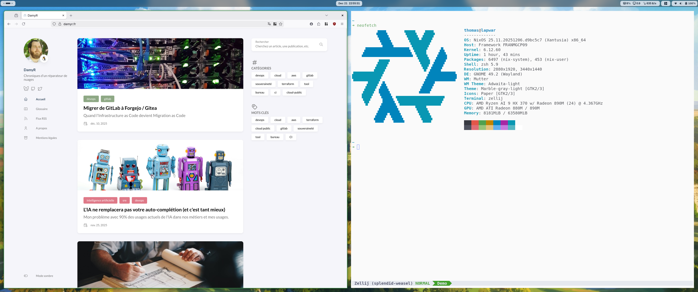

# NixOS Configuration

Personal NixOS configuration using flakes and home-manager.

## Overview

This repository contains declarative NixOS configurations for multiple machines, organized into modular components for easy maintenance and reusability.



## Machines

| Host | User | Profile |
|------|------|---------|
| **ghost** | `damyr` | Desktop system |
| **lapwar** | `thomas` | Work laptop (Waays) with professional tools |
| **dust** | `damyr` | Secondary system, partitioned with disko |

> Note: `lapwar` is built from `hosts/waays/` — the directory name and the
> flake attribute differ.

## Project Structure

```
.
├── flake.nix                 # Main flake (hosts, inputs, sofka overlay)
├── Makefile                  # check / build / update / clean targets
├── AGENTS.md                 # Repo gotchas for AI agents
├── hosts/                    # Host-specific configurations
│   ├── ghost/
│   │   ├── configuration.nix
│   │   └── hardware-configuration.nix
│   ├── waays/                # -> flake attribute `lapwar`
│   │   ├── configuration.nix
│   │   ├── disko.nix
│   │   └── hardware-configuration.nix
│   └── dust/
│       ├── configuration.nix
│       ├── disko.nix
│       └── hardware-configuration.nix
└── modules/                  # Modular configuration components
    ├── core/                 # System-level configuration
    │   ├── default.nix
    │   ├── user.nix
    │   ├── packages.nix
    │   ├── security.nix
    │   ├── services.nix
    │   └── system.nix
    ├── desktop/              # Desktop environments
    │   ├── default.nix
    │   ├── gnome.nix
    │   └── hyprland.nix      # Present but not enabled (GNOME only)
    ├── home/                 # Home-manager configurations
    │   ├── default.nix
    │   ├── home.nix          # Shell (zsh, starship, aliases) + user packages
    │   ├── home-manager.nix
    │   ├── agent.nix         # AI agents: claude-code, opencode, pi, rtk, skills
    │   ├── k9s.nix           # k9s with overridden python deps
    │   ├── kitty.nix
    │   ├── neovim.nix        # extraLuaConfig only; config synced from GitHub
    │   ├── zellij.nix
    │   └── pi/                # Pi assets (status-footer extension, theme)
    └── pro/                  # Professional laptop config (lapwar only)
        ├── default.nix
        ├── git.nix           # Per-remote git identity (see below)
        ├── packages.nix
        └── ssh.nix
```

## Flake Inputs

- **nixpkgs** — `nixos-unstable` (all hosts track unstable; no version pin)
- **home-manager** — follows nixpkgs
- **disko** — declarative partitioning (`lapwar` and `dust`)
- **sofka** — upstream flake, exposed as an overlay (`pkgs.sofka`) on every host

## Module Organization

### Core Modules
System-level configuration shared across all machines:
- **user.nix** - User account configuration
- **packages.nix** - Base system packages (also holds the git identity comment)
- **security.nix** - Security settings (AppArmor, firewall, etc.)
- **services.nix** - System services (daily auto-upgrade, GC, etc.)
- **system.nix** - Basic system settings (timezone, locale, networking)

### Desktop Modules
Desktop environment configurations:
- **gnome.nix** - GNOME desktop environment (enabled)
- **hyprland.nix** - Hyprland window manager (exists, import commented out)

### Home Modules
User-level configurations via home-manager:
- **home.nix** - Shell configuration (zsh, starship, aliases), git, user packages
- **agent.nix** - AI coding agents (`pi-coding-agent`, `opencode`, `claude-code`, `rtk`) and pinned external skill files
- **k9s.nix** - k9s (overrides `python311Packages.os-service-types` to add `typing-extensions`)
- **kitty.nix** - Kitty terminal emulator
- **neovim.nix** - Neovim (only injects `extraLuaConfig`; real config is synced at first login from `github.com/DamyrFr/neovim-config`)
- **zellij.nix** - Zellij terminal multiplexer

### Pro Modules
Professional laptop configurations (lapwar only):
- **packages.nix** - Professional tools (Framework utilities, Mattermost, etc.)
- **git.nix** - Per-remote git identity (`lib.mkForce`)
- **ssh.nix** - SSH configuration

## Installation

### Initial Setup

1. Clone this repository:
```bash
git clone <repository-url> ~/nixos-config
cd ~/nixos-config
```

2. Stage new files — flakes only see `git add`-ed files:
```bash
git add <new-files>
```

3. Build the configuration for your machine:
```bash
sudo nixos-rebuild switch --flake ~/nixos-config#<hostname>
```

Replace `<hostname>` with `ghost`, `lapwar`, or `dust`.

### Using the Alias

After the first rebuild, you can use the convenient alias:
```bash
nixupgrade
```

This automatically rebuilds the system for the current hostname.

## Making Changes

### Adding System Packages

Edit `modules/core/packages.nix` and add packages to the `environment.systemPackages` list:
```nix
environment.systemPackages = with pkgs; [
  # Your new package here
  package-name
];
```

### Adding User Packages

Edit `modules/home/home.nix` and add packages to the `home.packages` list:
```nix
home.packages = with pkgs; [
  package-name
];
```

### Adding Professional Packages (lapwar only)

Edit `modules/pro/packages.nix`:
```nix
home.packages = with pkgs; [
  package-name
];
```

### Modifying Shell Aliases

Edit the `shellAliases` section in `modules/home/home.nix`:
```nix
shellAliases = {
  alias-name = "command";
};
```

## Features

### System Configuration
- **OS**: NixOS (nixos-unstable channel)
- **Shell**: Zsh with starship prompt
- **Terminal**: Kitty with custom light theme
- **Editor**: Neovim (config synced from github.com/DamyrFr/neovim-config)
- **Desktop**: GNOME (Hyprland available but disabled)
- **Security**: AppArmor, ClamAV, automatic updates
- **Auto-upgrade**: daily, against the committed `flake.lock` (no auto-commit)
- **Garbage Collection**: weekly, generations older than 7 days
- **Boot**: systemd-boot, 5 entries kept

### Development Tools
- **Languages**: Python, Node.js, Go, Ruby
- **DevOps**: kubectl, k9s, terraform, opentofu, helm
- **Cloud**: Google Cloud SDK, OpenStack client, Scaleway CLI
- **Containers**: Podman, buildah, podman-compose
- **Virtualization**: virt-manager, vagrant

### Key Packages
- `tree` - Directory structure visualization
- `ripgrep` - Fast text search
- `fzf` - Fuzzy finder
- `kubectl` / `k9s` - Kubernetes management
- `terraform` / `opentofu` - Infrastructure as Code
- `pass` - Password manager
- `claude-code` - AI development assistant
- `pi-coding-agent` - AI coding agent (`pi`), configured in `modules/home/agent.nix`
- `opencode` / `rtk` - Additional coding agents, configured in `modules/home/agent.nix`

### Professional Tools (lapwar)
- `mattermost-desktop` - Team communication
- `framework-tool` - Framework laptop utilities
- `framework-tool-tui` - Framework laptop TUI
- `crush` - Shell scripting helper

## Git Configuration

The configuration includes global git settings:
- **Editor**: neovim
- **GPG Signing**: SSH key signing enabled
- **Useful aliases**: `lg` (pretty log), `am` (amend)
- **Pull strategy**: rebase

### Per-Remote Identity

Git identity is selected per remote via `includeIf`:
- `github.com` remotes → DamyR `<thomas@anvir.fr>`
- `git.waays.fr` remotes → tw `<tg@waays.fr>`

On `lapwar`, the default identity is overridden to tw via `modules/pro/git.nix`.

**Important**: the default identity must be set via `[include].path`, never an
inline `[user]` section — the NixOS `programs.git` module renders sections
alphabetically, so an inline `[user]` would always sort after `[includeIf]`
blocks and clobber the per-remote identities (Git is last-value-wins).

## Customization

### Changing Theme
The Kitty terminal uses a light theme (One Light inspired). To modify:
```bash
nvim modules/home/kitty.nix
```

### Changing Desktop Environment
Currently configured for GNOME. To switch to Hyprland or add another DE, modify the imports in your host-specific configuration.

### Adding a New Machine

1. Create a new directory in `hosts/` (add `disko.nix` if the machine should be declaratively partitioned):
```bash
mkdir -p hosts/new-machine
```

2. Create `hosts/new-machine/configuration.nix` (and `hardware-configuration.nix`)

3. Add the configuration to `flake.nix`:
```nix
new-machine = nixpkgs.lib.nixosSystem {
  system = "x86_64-linux";
  specialArgs = {
    username = "your-username";
    hostname = "new-machine";
  };
  modules = [
    overlays
    ./hosts/new-machine/configuration.nix
    # ./hosts/new-machine/disko.nix      # + disko.nixosModules.disko
    ./modules/core
    ./modules/desktop
    ./modules/home
    # ./modules/pro                       # for work machines

    home-manager.nixosModules.home-manager
    {
      home-manager.useGlobalPkgs = true;
      home-manager.useUserPackages = true;
      home-manager.backupFileExtension = "backup";
      home-manager.extraSpecialArgs = {
        username = "your-username";
      };
      home-manager.users.your-username = import ./modules/home/home.nix;
    }
  ];
};
```

## Maintenance

### Update Flake Inputs
```bash
nix flake update          # or: make nix-flake-update (also updates sofka)
```

The lock is shared across all hosts — bump inputs deliberately and commit.
Daily auto-upgrade rebuilds against the committed lock without updating it.

### Validate
```bash
nix flake check           # or: make check
```

### Garbage Collection
Automatic garbage collection runs weekly, removing generations older than 7 days.

Manual garbage collection:
```bash
sudo nix-collect-garbage --delete-older-than 7d
```

### List Generations
```bash
sudo nix-env --list-generations --profile /nix/var/nix/profiles/system
```

### Rollback
```bash
sudo nixos-rebuild switch --rollback
```

## Troubleshooting

### Build Fails
1. Ensure all files are tracked by git (flakes only include tracked files)
2. Check for syntax errors in nix files
3. Use `--show-trace` for detailed error messages:
```bash
sudo nixos-rebuild build --flake ~/nixos-config#<hostname> --show-trace
```

### Git Permission Issues
If you encounter git permission errors:
```bash
sudo chown -R $USER:users ~/nixos-config/.git
```

## License

Personal configuration - use at your own risk.

## Credits

- NixOS: https://nixos.org
- Home Manager: https://github.com/nix-community/home-manager
- Disko: https://github.com/nix-community/disko
- Sofka: https://github.com/nklmilojevic/sofka
